# 3D nástroje

Bezplatné nástroje pro 3D tisk v češtině. Všechno se počítá přímo v prohlížeči, nic se nikam neodesílá a nástroje fungují i na mobilu a bez internetu.

**Created by Julius Andy Antoš**

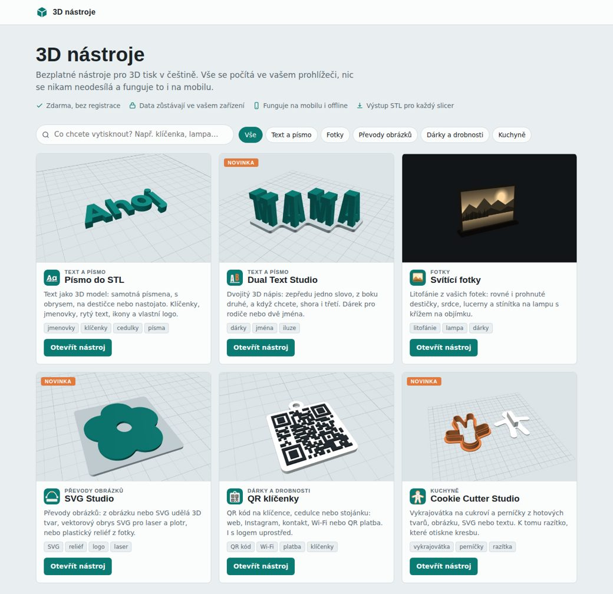

## Nástroje

| | Nástroj | Co umí |
|---|---|---|
| 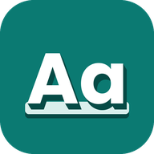 | **Písmo do STL** | Text jako 3D model: samotná písmena, s obrysem, na destičce nebo nastojato. Klíčenky, jmenovky, rytý text, ikony, vlastní logo. |
| 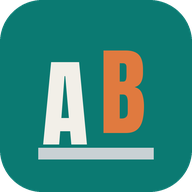 | **Dual Text Studio** | Dvojitý 3D nápis: zepředu jedno slovo, z boku druhé. |
|  | **Svítící fotky** | Litofánie z fotek: rovné a prohnuté destičky, srdce, lucerny a stínítka na lampu s křížem na objímku. |
| 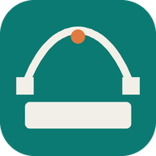 | **SVG Studio** | Z obrázku nebo SVG udělá 3D tvar, vektorový obrys SVG nebo plastický reliéf z fotky. |
| 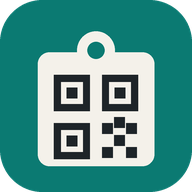 | **QR klíčenky** | QR kód na klíčence, cedulce nebo stojánku: web, sociální sítě, kontakt, Wi-Fi, QR platba, logo uprostřed. |
|  | **Cookie Cutter Studio** | Vykrajovátka na cukroví z tvarů, obrázku, SVG nebo textu, k tomu razítko s reliéfem. |
|  | **Krabičky a organizéry** | Krabička s přihrádkami a nasazovacím nebo posuvným víčkem (i s nápisem), Gridfinity boxy a podložky do šuplíku. |
| 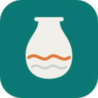 | **Vázy a lampy** | Vázy, květináče s podmiskou a stínidla s vlnami, žebry a zkroucením, pro režim váza nebo se stěnou. |
| 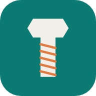 | **Závity a šrouby** | Šrouby, matice, podložky a závitové tyče s metrickým (M2–M30) i trapézovým závitem, různé hlavy a drážky, kabelové průchodky PG i metrické, závit do vlastního STL. |
|  | **Ozubená kola** | Evolventní kola a pastorky (rovné, šikmé, šípové), vnitřní věnce, hřebeny, dvojice kol a planetové převodovky. |
| 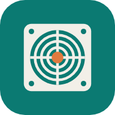 | **Mřížky na ventilátor** | Mřížky na ventilátory 25–140 mm, různé vzory, rovné nebo vyklenuté (kužel, kopule), s výpočtem volné plochy. |
| 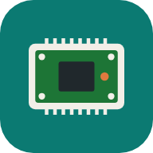 | **Elektronika – držáky a panely** | Podložky se sloupky pro Raspberry Pi, Arduino a ESP desky, kolébky pro desky bez děr, panely pro OLED a LCD, LED panely a objímky, profily na LED pásky, šablona otvorů v SVG. |
| 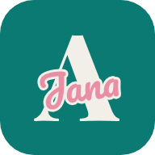 | **Jmenovky – písmeno se jménem** | Velké 3D písmeno se vsazeným jménem psacím písmem a obrysem, tisk vcelku (výměna filamentu nebo AMS) i po dílech na slepení. |
| 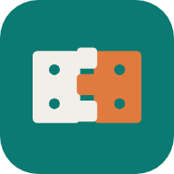 | **Panty** | Panty tištěné vcelku, na kolík (filament, hřebík, šroub M3–M5), pružné panty a zkušební sada vůlí s vyrytými čísly. |
| 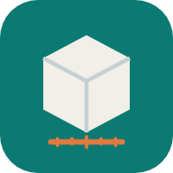 | **Kalibrační testy** | Kostka, teplotní věž, převisy, mosty, vůle a vlasení, s návodem na vyhodnocení. |
| 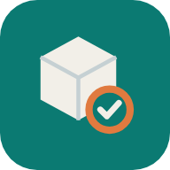 | **Kontrola STL** | Prohlížeč STL, OBJ a 3MF: rozměry, hmotnost, cena, kontrola děr a převisů, oprava, zjednodušení, převod formátů a nejlepší natočení k tisku. |
| 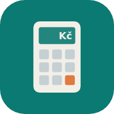 | **Kalkulačka ceny tisku** | Cena výtisku včetně vícebarevného tisku: filament, odpad z výměn barev, elektřina, opotřebení, práce, marže a DPH. Načte čas a gramy z G-code nebo .gcode.3mf. |

Nástroje, které vytvářejí modely, je stahují jako **STL** (jednotky mm), který otevřete v libovolném sliceru (Bambu Studio, PrusaSlicer, Creality Print, Cura). Modely jsou uzavřená tělesa připravená k tisku.

## Spuštění

- **Online:** složka [`docs/`](docs) je hotový web. Zapněte GitHub Pages (*Settings → Pages → Branch: `main`, složka `/docs`*) a web poběží na adrese `https://<uživatel>.github.io/3d-nastroje/`.
- **Na vlastním serveru:** obsah složky `docs/` nahrajte přes FTP, např. do `www/3d-nastroje/`. Server nepotřebuje nic dalšího. PHP je potřeba jen pro volitelný seznam vlastních písem v Písmu do STL (`fonts/list.php`).
- **Bez internetu:** po sestavení najdete ve `dist/offline/` každý nástroj jako jeden HTML soubor, stačí ho otevřít v prohlížeči.

## Struktura

```
build.py               sestavení webu a offline verzí
src/
  hub/                 rozcestník (index.html, nastroje.js = seznam nástrojů, styl.css, img/)
  shared/              společný kód: geometrie, převody obrázků, litofánie
  vendor/              přibalené knihovny (three.js, opentype.js, Clipper, qrcode, jsQR, Manifold)
  fonts/               písma (zmenšená na české znaky)
  <nástroj>/           stránka nástroje (*.html), jeho kód (*-app.js), pwa/ (ikony, manifest, offline režim)
docs/                  sestavený web (vzniká příkazem python build.py)
```

Stránka nástroje obsahuje značky jako `/*__CORE__*/` nebo `/*__APP__*/` a `build.py` je nahradí obsahem souborů a knihovnami. Díky tomu je každý nástroj na webu jediný soubor `index.html`, který funguje i offline.

## Úpravy a sestavení

```bash
pip install -r requirements.txt   # jen poprvé (fonttools)
python build.py                   # sestaví rozcestník a všechny nástroje
python build.py qr-klicenky       # jen jeden nástroj
```

Po úpravě v `src/` spusťte `python build.py`, zkontrolujte `docs/` v prohlížeči a změny nahrajte (commit + push). GitHub Pages se aktualizují samy.

### Vyhledávače

`build.py` vytvoří `docs/sitemap.xml` (mapu webu pro Google) a do každého nástroje doplní popis a kanonickou adresu z `src/hub/nastroje.js`. Adresa webu je v `build.py` v proměnné `SITE`. Při přesunu na vlastní doménu ji stačí změnit a web znovu sestavit.

### Přidání nového nástroje

1. Vytvořte složku `src/novy-nastroj/` se stránkou, kódem a složkou `pwa/` (stačí zkopírovat z jiného nástroje a upravit).
2. Doplňte nástroj do slovníku `TOOLS` v `build.py`.
3. Na rozcestník ho přidáte v `src/hub/nastroje.js` (jeden blok textu) a do `src/hub/img/` dáte náhled `novy-nastroj.jpg` (640 × 400) a ikonu `novy-nastroj-ikona.png`.
4. Spusťte `python build.py`.

## Licence

Kód je pod licencí [MIT](LICENSE): můžete ho volně používat i upravovat, jen zachovejte uvedení autora a licenci.
Přibalené knihovny a písma mají vlastní licence, viz [THIRD-PARTY.md](THIRD-PARTY.md).

---

*English: Free browser-based tools for 3D printing (text to STL, lithophanes, QR keychains, cookie cutters, SVG/relief conversion, dual-text illusions). Everything runs locally in the browser. Czech UI. MIT licensed.*
